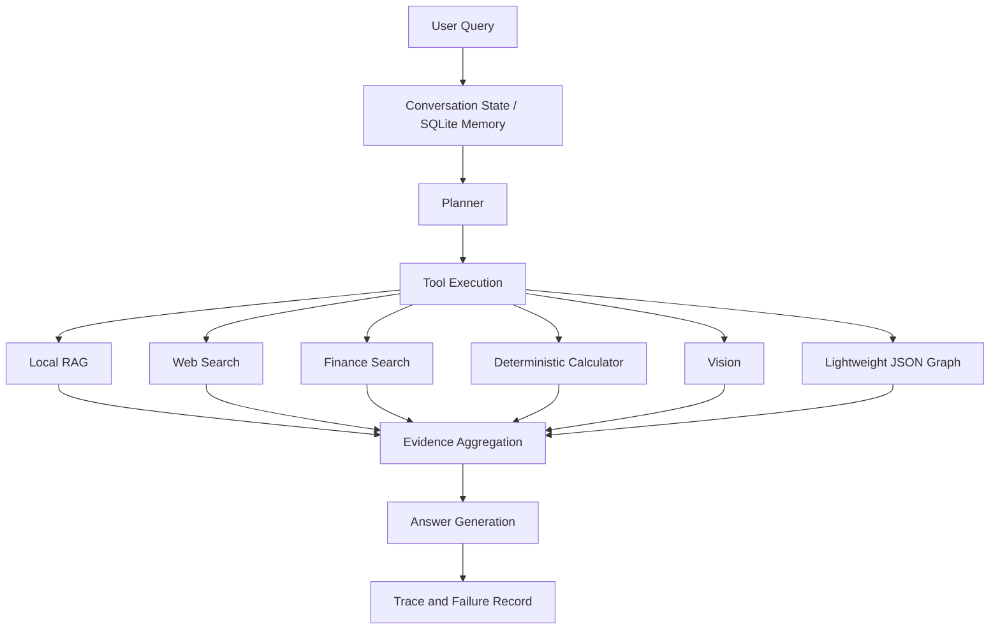

# AutoSales-Agent

[中文说明](README.zh-CN.md) · [Demo Portfolio](docs/demo/README.md)

> A multi-tool conversational Agent prototype for EV sales consulting, integrating local RAG, tool calling, multimodal understanding, stateful memory, evidence traceability, and failure-aware execution.


AutoSales-Agent is a **single Agent coordinating multiple specialized tools**, rather than a conventional retrieve-and-generate chatbot. It is designed around a practical EV sales-consulting workflow: decide whether to retrieve product facts, search current information, validate official finance sources, perform exact calculations, use image context, or answer directly.

The project focuses on agent-engineering reliability: planning versus execution, parameter validation, evidence-to-answer traceability, safe failure handling, persistent conversation state, and evaluation-driven decisions.

## Highlights

- Multi-tool orchestration across local RAG, web search, official-source finance search, deterministic calculators, vision, and a lightweight JSON relation layer.
- Stateful multi-turn sessions with SQLite-backed memory for city, budget, purchase timing, model interest, financing preference, recent turns, and a bounded vision summary.
- Unified evidence objects that connect retrieval, calculations, graph relations, visual results, and tool output to final-answer claims.
- Failure-aware execution for planner errors, retrieval issues, web timeouts, finance-source validation failures, invalid calculator input, vision failures, graph misses, and partial multi-tool failures.
- Shared CLI and FastAPI service layer; HTTP is an adapter over the same Agent core rather than a second implementation.
- Evaluation coverage for routing, execution, retrieval, evidence, robustness, memory, graph behavior, and API behavior.
- A frozen independent retrieval validation that rejected a ranking candidate which did not generalize beyond development data.

## Why This Project?

A basic RAG chatbot answers every question by retrieving text and asking an LLM to generate a response. Sales-consulting interactions need more control: a loan question needs exact arithmetic, a current financing question needs verifiable sources, a missing parameter needs a follow-up rather than a guess, and an unavailable tool must not become fabricated evidence.

This project treats the LLM primarily as a semantic planner, parameter-understanding component, and response generator. Deterministic calculation, retrieval, source validation, and persistence are handled by dedicated components.

## System Architecture



The complete component boundaries, inputs, outputs, and failure behavior are documented in [docs/final_architecture.md](docs/final_architecture.md).

## Agent Workflow

```text
Plan -> Validate -> Execute -> Aggregate Evidence -> Generate -> Trace
```

1. **Plan**: select no tool, one tool, or multiple tools based on the user request and conversation state.
2. **Validate**: normalize calculator parameters and check required slots before an exact calculation is allowed to run.
3. **Execute**: invoke the selected tool(s), keeping `planned_tools` separate from `executed_tools`.
4. **Aggregate evidence**: convert successful tool output into evidence items with source, validation state, and metadata.
5. **Generate**: answer from available evidence and clearly preserve unavailable-evidence boundaries.
6. **Trace**: store planning, execution, evidence, citations/claim mappings, performance fields, and failure events.

For example, a loan task with a missing interest rate can correctly have `planned_tools = [car_calculator]` and `executed_tools = []`; the Agent asks for the missing slot instead of guessing or treating the missing execution as a routing error.

## Tool System

| Tool | Purpose | Typical use |
| --- | --- | --- |
| Local RAG | Retrieve local product facts | Specifications, charging, warranty, cockpit features |
| Web Search | Retrieve non-financial external information | Current public information, competitor updates |
| Finance Search | Retrieve verified official finance information | Bank financing plans and official financial policies |
| Calculator | Perform deterministic arithmetic | Monthly payment, energy cost, purchase budget |
| Vision | Analyze a local image path with the configured vision model | Vehicle, cockpit, charging, ADAS, or price-page images |
| Lightweight Knowledge Graph | Match JSON relations | Product-feature and user-need-to-configuration relations |

Finance search is intentionally stricter than ordinary web search. A result without a verifiable official financial source is not adopted as a financing recommendation.

## Deterministic Calculation and Missing Slots

The Agent does not ask an LLM to perform financial or energy arithmetic directly.

```text
LLM planning / parameter extraction
  -> normalization and preflight validation
  -> deterministic calculator
  -> structured calculation evidence
  -> answer claim
```

The calculator supports equal-payment loan estimates, annual electricity-cost estimates, and purchase-budget estimates. Natural conversational forms such as “首付三成”, “36个月”, “每年1.5万公里”, and “电价0.6元一度” are normalized before calculation.

For a loan estimate, the required slots are car price, down-payment ratio, term, and annual interest rate. Missing values trigger a targeted follow-up; an explicit pause or cancellation prevents calculator execution. The result remains an estimate rather than a financial institution’s final quote.

## Retrieval-Augmented Generation

### Pipeline

```text
Authorized document -> PDF parsing -> chunking -> embedding -> local JSON vector store
    -> semantic score + lexical signal -> ranking -> top-4 evidence
```

`ingest.py` parses a configured PDF, chunks it, embeds the chunks, and writes a local JSON vector store at `RAG_DB_PATH`. The embedding backend is configurable: local hash embeddings, a local BGE model, or a DashScope-compatible embedding endpoint such as `text-embedding-v4`.

### Final Runtime Ranking

The frozen runtime retrieval policy is:

```text
R0 = lexical_first
Top-K = 4
```

R0 ranks by lexical score first and uses semantic score to break lexical ties. This design is useful for product materials containing exact terms and numbers such as power, screen size, warranty, and charging specifications.

## Evaluation-Driven Retrieval Optimization

The repository preserves a ranking decision process rather than presenting an unvalidated tuning result.

```text
Ranking error audit
  -> score-fusion hypothesis
  -> controlled development experiment
  -> R3 candidate frozen
  -> new independent set constructed and human-reviewed
  -> blind R0 vs R3 validation
  -> R3 regression detected
  -> R3 rejected; R0 retained
```

The 27-case ranking development set was used for error analysis and candidate selection. The separate frozen validation set contains 48 human-verified cases, including 45 positive retrieval cases and 3 unsupported-boundary cases. The three unsupported cases are excluded from positive-retrieval denominators.

| Strategy | Hit@1 | Hit@4 | Recall@4 | MRR | Decision |
| --- | ---: | ---: | ---: | ---: | --- |
| R0 lexical-first | 77.78% | 97.78% | 91.85% | 86.11% | Retained |
| R3: 0.7 semantic + 0.3 lexical | 73.33% | 97.78% | 91.85% | 83.33% | Rejected |

R3 fixed 2 cases but broke 4 cases, for a net Top-1 change of -2. It improved the numeric-fact slice but regressed on direct-fact and paraphrased-fact slices. The conclusion is not that semantic retrieval is generally worse; it is that this tested fixed global fusion did not generalize consistently across the evaluated query categories.

> A candidate was not promoted merely because it improved development data. It was frozen and evaluated once on a separately constructed, human-reviewed validation set before the runtime decision was made.

See [the runtime ranking audit](eval/report/final/runtime_ranking_audit.md) and [the frozen validation summary](eval/report/ranking_validation/results/validation_summary.md).

## Evidence and Traceability

Successful tool results become normalized evidence items. Local RAG chunks, web results, finance sources, calculator output, graph relations, and vision output share an evidence path into answer generation.

```text
Tool result -> evidence_id -> answer citation or claim_evidence mapping
```

Calculator output additionally retains normalized inputs and structured numerical result metadata, so key answer values can be traced back to deterministic computation instead of relying on string matching alone.

Each request receives a `trace_id`. The trace records query/state context, planned and executed tools, tool calls, evidence, answer mappings, performance fields, and failure events. API trace responses are sanitized and retained only in the current service process.

## Failure-Aware Execution

Failure is handled as an explicit execution state, not as a reason to invent an answer. The current failure-injection suite covers planner failure, local retrieval failure, web and finance failures, invalid calculator input, vision failure, graph failure, and partial multi-tool failure.

| Current failure-injection suite: 25 cases | Result |
| --- | ---: |
| Failure detection | 100% |
| Failure recovery | 100% |
| Unsafe fallback | 0% |
| Partial success | 100% |
| Error classification | 100% |

These are scoped regression results for the current 25-case suite, not a global reliability guarantee.

## Stateful Multi-turn Memory

Persistent memory uses SQLite and stores session-scoped profile information: city, budget, purchase timing, interested model, loan preference, recent turns, and a bounded vision summary. It supports session isolation, cross-process recovery, and explicit clearing.

The current persistent-memory suite reports 15/15 passing cases. Runtime memory is created locally at `data/memory.db` and is intentionally excluded from the public source-only package.

## Multimodal Vision

The configured vision model is `qwen-vl-plus`. It can analyze a local image path with an optional question and write a bounded result summary into the active session; later Agent turns can use that state as evidence.

Vision is useful for product, cockpit, charging, driver-assistance, and price-page images. Unreadable or absent information should remain unknown. The current vision output is not yet normalized into a richer dedicated semantic JSON schema.

## Lightweight Knowledge Graph

The knowledge graph is a lightweight JSON-based relation layer, not a large-scale graph database. It provides additional relations such as product-to-feature and user-need-to-configuration matches. A graph miss contributes no graph evidence; it is not treated as a fact.

## Evaluation

| Evaluation layer | Scope | Result |
| --- | --- | --- |
| Tool routing baseline | 38 development cases | 38/38 |
| Calculator baseline | 8 development cases | 8/8 |
| Independent Agent behavior | 60 cases | 56/56 deterministic; 4 human-reviewed semantic cases |
| Real Agent E2E | 21 runnable cases | 21/21; planning 100%, execution 100% |
| Evidence | 21 E2E runnable cases | Coverage 1.0; evidence gap 0 |
| Failure recovery | 25 injected-failure cases | 25/25; unsafe fallback 0% |
| Persistent memory | 15 cases | 15/15 |
| Knowledge graph | 3 cases | 3/3 |
| API E2E | 18 TestClient checks plus Uvicorn smoke | PASS |
| Development retrieval baseline | 27 cases | Hit@1 40.74%; Hit@4 92.59%; Recall@4 76.54%; MRR 61.11% |
| Frozen independent retrieval validation | 45 positive / 48 total human-verified cases | R0 Hit@1 77.78%; Hit@4 97.78%; Recall@4 91.85%; MRR 86.11% |

These metrics belong to different scoped suites. They should not be collapsed into one overall score or interpreted as a production-readiness claim.

Final reports: [evaluation summary](eval/report/final/FINAL_EVALUATION.md), [evaluation matrix](eval/report/final/final_evaluation_matrix.md), and [known limitations](eval/report/final/limitations.md).

## Quick Start

> **Data note:** The public source-only package intentionally excludes the evaluated product corpus, derived knowledge assets, vector store, runtime database, and raw traces. These assets are generated, private, or pending provenance/licensing review.

### Installation

```bash
git clone <your-repository-url>
cd AutoSales-Agent
python -m venv .venv
source .venv/bin/activate
pip install -r requirements.txt
```

On Windows, activate the environment with:

```powershell
.venv\Scripts\activate
```

### Configuration

```bash
cp .env.example .env
```

Set `OPENAI_API_KEY` only in your private `.env` if you want model generation or compatible remote embeddings. `OPENAI_BASE_URL` and `OPENAI_MODEL` are configured for an OpenAI-compatible endpoint. Never commit `.env`.

Keep the frozen runtime setting:

```text
RAG_RANKING_STRATEGY=lexical_first
```

See [docs/configuration_guide.md](docs/configuration_guide.md) for all supported fields.

### Data Setup and Ingestion

Place a PDF that you are authorized to use at the path configured by `PDF_PATH` (the template uses `data/your_document.pdf`), then build the local store:

```bash
python app.py ingest
```

This produces the local JSON store configured by `RAG_DB_PATH`. The excluded JSON graph is optional; without a local graph asset, graph relations simply provide no additional evidence.

### Chat CLI

```bash
python app.py chat
python app.py chat --session demo
```

Interactive commands:

```text
/memory
/clear_memory
/clear_vision
/vision path/to/image.png
```

### Vision CLI

```bash
python app.py vision path/to/image.png --question "Identify visible vehicle configuration; mark unreadable fields as unknown."
```

### FastAPI

```bash
uvicorn api.server:app --host 127.0.0.1 --port 8000
```

Open `http://127.0.0.1:8000/docs` for the generated OpenAPI interface.

## API Example

```bash
curl -X POST http://127.0.0.1:8000/chat \
  -H "Content-Type: application/json" \
  -d '{"session_id":"demo","message":"车价30万，首付30%，贷款3年，年利率3.5%，算月供"}'
```

Available endpoints:

- `GET /health`
- `POST /chat`
- `POST /vision`
- `GET /sessions/{session_id}/memory`
- `DELETE /sessions/{session_id}/memory`
- `GET /traces/{trace_id}`

See [docs/api_quick_reference.md](docs/api_quick_reference.md) for request and response shapes.

## Project Structure

```text
AutoSales-Agent/
├── app.py                    # CLI entry point
├── agent.py                  # Agent orchestration and trace lifecycle
├── planner.py                # Tool planning
├── answer.py                 # Evidence-grounded answer generation
├── calculators.py            # Deterministic calculations
├── parameter_parser.py       # Conversational parameter normalization
├── ingest.py                 # Document ingestion
├── embeddings.py             # Embedding backends
├── vector_store.py           # Local JSON vector store and ranking
├── web_search.py             # Web and finance retrieval
├── vision.py                 # Vision integration
├── graph.py                  # Lightweight JSON relation layer
├── memory_store.py           # SQLite persistent memory
├── api/                      # FastAPI adapter and schemas
├── config/                   # Frozen runtime snapshot
├── eval/                     # Evaluation, ranking, and regression runners
├── docs/                     # Architecture and release documentation
├── .env.example
└── requirements.txt
```

## Design Principles

1. **Reason with the LLM; calculate with deterministic tools.**
2. **Planned tools and executed tools are distinct evaluation concepts.**
3. **Failed or unvalidated tool output must not become successful evidence.**
4. **Use development data to explore; use frozen independent validation to decide.**

## Limitations

- Evaluation uses one local EV product corpus and does not establish open-domain generalization.
- The public source-only package excludes the evaluated corpus and related local assets pending provenance/licensing review.
- The accepted R0 strategy retains one frozen positive case outside top-4 and several top-1 misses.
- Web and finance behavior depends on external provider availability; finance search fails closed without a verifiable official source.
- Vision output is model-generated and not independently calibrated as a fully structured extraction schema.
- The JSON graph is a lightweight relation store, not a large-scale knowledge graph.
- This version does not include production deployment controls such as authentication, rate limiting, CI/CD, or service monitoring.
- The project contains no LLM fine-tuning and makes no production-readiness claim.

## Future Work

- Investigate retained retrieval errors with a new versioned development set, without tuning on the frozen benchmark.
- Explore query-adaptive ranking or reranking under a new independent validation protocol.
- Formalize a richer structured Vision JSON output.
- Add Docker, CI, and deployment controls.
- Expand independent evaluation and provide a separately licensed synthetic or public demo corpus.

## Version

**v1.0-eval** freezes the evaluated core runtime: R0 `lexical_first`, top-k=4, and the final evaluation record. Future core-behavior changes should use a new version rather than retroactively changing this freeze.

License has not yet been selected.
